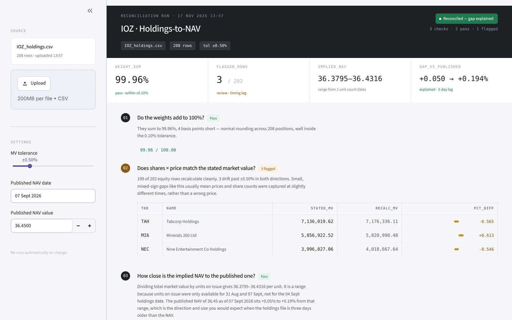

# ETF Holdings-to-NAV Reconciliation (IOZ)

A data validation project that checks whether the published holdings of **IOZ** (iShares Core S&P/ASX 200 ETF, about AUD 9.5B) add up to its published NAV, and explains every difference it finds.



## At a glance

| | |
|---|---|
| **Positions checked** | 208 holdings rows, including 202 equities |
| **Fund value** | AUD 9.53B total market value (holdings as of 04 Sept 2026) |
| **Market value check** | 199 of 202 equities recalculate within ±0.5%; 3 flagged |
| **NAV gap** | Published NAV is +0.05% to +0.19% above the implied NAV range |
| **Built with** | Python · pandas · Streamlit |

**What this project shows:** reading a messy real-world file, building independent checks, and tracing every discrepancy to a likely cause instead of just reporting a number.

> Educational project, not investment advice. Holdings data is from BlackRock's public IOZ product page and is used here for learning purposes only.

## The question

An ETF publishes its holdings, its net asset value (NAV) per unit and its units on issue, but these come from different sources and are not always dated the same day. Do they actually agree, and if not, why not?

## Data sources

| Input | Source | Date |
|---|---|---|
| Holdings (`IOZ_holdings.csv`) | BlackRock IOZ product page, holdings download | 04 Sept 2026 |
| Units on issue: 261,944,479 | ASX announcement | 31 Aug 2026 |
| Units on issue: 261,569,479 | BlackRock product page | 07 Sept 2026 |
| Published NAV: AUD 36.45 | BlackRock product page | 07 Sept 2026 |

The holdings file is parsed automatically. The units on issue and published NAV are entered by hand from the sources above (the NAV can be changed in the dashboard sidebar).

## The checks

1. **Do the weights add to 100%?** They sum to 99.96%, 4 basis points short. That is normal rounding and well inside a ±0.10% tolerance. **Pass.**
2. **Does shares × price × FX match the stated market value?** 199 of 202 equity rows match within ±0.5%. Three do not:

   | Ticker | Name | Difference |
   |---|---|---|
   | TAH | Tabcorp Holdings | −0.565% |
   | MI6 | Minerals 260 Ltd | +0.613% |
   | NEC | Nine Entertainment Co Holdings | −0.546% |

   The gaps are small and go in both directions, which suggests prices and share counts were captured at slightly different times rather than a wrong price. **Flagged for review.**
3. **How close is the implied NAV to the published NAV?** Total market value divided by units on issue gives AUD 36.3795 to 36.4316 per unit. It is a range because units on issue were only available for 31 Aug and 07 Sept, not for the 04 Sept holdings date. The published NAV of AUD 36.45 sits **+0.05% to +0.19%** above that range. **Pass.**

## What explained the differences

| Cause | Finding | Explanation |
|---|---|---|
| Timing lag | Three market values off by about 0.5% | Prices and share counts captured at slightly different times |
| Identifier mismatch | `PDI` and `PDIDB` are both "Predictive Discovery" | `PDIDB` is the live position. `PDI` has zero shares and zero value, a stale leftover that can be dropped |
| Reporting dates | Published NAV +0.05% to +0.19% above implied NAV | Consistent with the holdings file being three days older than the NAV, plus the range in units on issue |

## Files

| File | Purpose |
|---|---|
| `etf_reconciliation.py` | Runs every check and prints the results |
| `dashboard.py` | Streamlit dashboard: verdict, KPIs, each check step by step, and the root causes. You can upload a new holdings CSV and change the tolerance and published NAV |
| `IOZ_holdings.csv` | IOZ holdings as of 04 Sept 2026 |
| `.streamlit/config.toml` | Dashboard theme |

## How to run

```bash
python3 -m venv .venv
source .venv/bin/activate
pip install -r requirements.txt

python etf_reconciliation.py   # prints the reconciliation report
streamlit run dashboard.py     # opens the dashboard
```

## Limitations

- A single snapshot: one holdings date compared with one published NAV.
- Units on issue were not available for the holdings date, so the implied NAV is a range rather than a single number.
- Units on issue and the published NAV are entered by hand, and they are specific to IOZ. Uploading another fund's holdings in the dashboard would need these updated too.
- Cash, accrued income and fees are not modelled separately; they sit inside the total market value from the holdings file.
